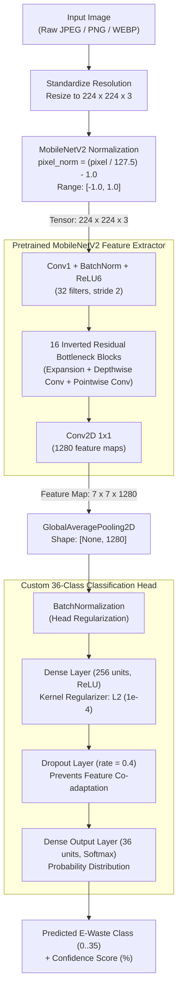

# TechCycle — E-Waste Management & Recycling Intelligence Platform

[](https://react.dev/)
[](https://fastapi.tiangolo.com/)
[](https://keras.io/)
[](https://firebase.google.com/)

**TechCycle** is a full-stack sustainability platform engineered to address the global electronic waste crisis. Combining transfer learning computer vision, interactive recycling facility maps, an e-waste marketplace, and an AI advisory chatbot, TechCycle empowers consumers, businesses, and certified recyclers to divert hazardous components from landfills and recover valuable secondary raw materials.

---

## Table of Contents

- [Overview & Problem Statement](#overview--problem-statement)
- [Key Features](#key-features)
- [System Architecture](#system-architecture)
- [CNN Deep Learning Architecture](#cnn-deep-learning-architecture)
- [Deep Learning Pipeline](#deep-learning-pipeline)
- [Technology Stack](#technology-stack)
- [Project Directory Structure](#project-directory-structure)
- [Prerequisites & Environment Setup](#prerequisites--environment-setup)
- [Installation & Local Run Guide](#installation--local-run-guide)
  - [1. Backend Setup (FastAPI & ML Inference)](#1-backend-setup-fastapi--ml-inference)
  - [2. Frontend Setup (React Application)](#2-frontend-setup-react-application)
- [Testing & Quality Assurance](#testing--quality-assurance)
- [Security & Repository Safety](#security--repository-safety)
- [License](#license)

---

## Overview & Problem Statement

Over 57 million metric tons of electronic waste are discarded annually, yet less than 20% is documented as formally collected and recycled. Discarded electronics contain hazardous heavy metals (lead, mercury, cadmium) that contaminate groundwater, alongside high-value precious metals (gold, copper, palladium) that can be reclaimed at fractions of the carbon cost of virgin mining.

**TechCycle bridges this gap by providing:**
1. **Instant Component Recognition:** An AI-powered vision scanner that classifies 36 distinct discrete electronics and PCB components from user-uploaded images and prescribes certified environmental handling directives.
2. **Circular Economy Marketplace:** A peer-to-peer exchange where working components, test gear, and repairable electronics can be listed, bought, or salvaged instead of dumped.
3. **Geo-Enabled Collection Hubs:** Interactive mapping to locate certified municipal drop-offs and verified e-waste recyclers.
4. **Intelligent Sustainability Assistant:** An integrated Google Gemini conversational agent trained on e-waste lifecycle guidance and disposal regulations.

---

## Key Features

### 🔍 AI Component Scanner (`/profile/awareness`)
- **Neural Image Classification:** Upload or drag-and-drop photos of circuit boards, semiconductors, passives, or power electronics.
- **36 Verified E-Waste Classes:** Distinguishes capacitors, microprocessors, relays, heatsinks, transformers, and ICs.
- **Safety Directives:** Generates contextual handling protocols (e.g., electrolyte hazards, battery extraction, precious metal refining).
- **Confidence Calibration:** Real-time visual confidence metrics with automatic low-confidence warnings below 40%.

### 🛒 Circular Marketplace (`/profile/info`)
- Browse, search, filter, and sort refurbished electronics by category, price, and condition.
- List devices for sale or salvage with image upload support.
- User wishlists, direct messaging to sellers, and real-time listing management.

### 🗺️ Geo-Location Recycling Locator (`/profile/map`)
- Integrated interactive maps displaying verified collection centers, hours, and accepted electronic waste streams.

### 🤖 Gemini-Powered E-Waste Assistant
- Built-in conversational AI answering queries regarding safe hazardous material handling, battery disposal, and e-waste policies.

### 🔐 Secure Identity & Cloud Database
- Multi-provider authentication (Email/Password and Google OAuth) powered by Firebase Auth.
- Idempotent user profile synchronization with Cloud Firestore (`users/{uid}`).
- Granular Firestore & Firebase Storage security rules enforcing document ownership.

---

## System Architecture

The following diagram illustrates the end-to-end dataflow between the client application, Google Cloud/Firebase services, and the FastAPI deep learning inference backend:

```mermaid
flowchart TB
    %% Client Tier
    subgraph ClientTier ["Frontend Client Tier • React 19 (Port 3000)"]
        direction TB
        UI["User Interface (SPA Components)"]
        Scanner["AI Scanner UI (/profile/awareness)"]
        Marketplace["Marketplace & Wishlist (/profile/info)"]
        MapUI["Recycling Center Map (/profile/map)"]
        ChatbotUI["Gemini Chatbot Widget"]
        AuthContext["AuthProvider (State & Token Cache)"]
    end

    %% Cloud Services Tier
    subgraph CloudTier ["Cloud & Managed Services Tier (Firebase / GCP)"]
        direction TB
        FirebaseAuth["Firebase Authentication\n(Email/Password & Google OAuth)"]
        Firestore[("Cloud Firestore\n(users, marketplace, wishlist, messages)")]
        Storage[("Firebase Storage\n(devices/{userId} images)")]
        GeminiAPI["Google Gemini Generative AI API"]
    end

    %% Inference Backend Tier
    subgraph InferenceTier ["Backend ML Inference Tier • FastAPI & Uvicorn (Port 8000)"]
        direction TB
        Router["FastAPI Application (app.py)\nEndpoints: /health, /identify-ewaste"]
        Pipeline["Inference Controller (predict_component.py)"]
        Preprocess["Preprocessing Engine\n(224x224 RGB, [-1.0, 1.0] scaling)"]
        Labels[("Class Metadata (class_labels.json)\n36 Component Classes & Safety Guides")]
        ModelEngine["Model Runtime (Keras 3 / TensorFlow 2.15)\ncomponent_classifier.keras"]
    end

    %% User Interaction
    User([End User / Recycler]) <-->|HTTPS / Browser| UI
    UI --> Scanner
    UI --> Marketplace
    UI --> MapUI
    UI --> ChatbotUI

    %% Client to Cloud Integrations
    UI <-->|Manage Auth Sessions| AuthContext
    AuthContext <-->|OAuth / Identity Tokens| FirebaseAuth
    Marketplace <-->|Firestore Queries & Realtime Updates| Firestore
    Marketplace <-->|Upload / Download Device Photos| Storage
    ChatbotUI <-->|Prompt & Response Stream| GeminiAPI

    %% Client to FastAPI Backend
    Scanner -->|POST /identify-ewaste\n(Multipart Image Upload)| Router
    Router --> Pipeline
    Pipeline --> Preprocess
    Preprocess -->|Preprocessed Tensor [1, 224, 224, 3]| ModelEngine
    ModelEngine -->|Softmax Probability Vector [1, 36]| Pipeline
    Pipeline <-->|Query Label & Safety Directive| Labels
    Pipeline -->|JSON: prediction, confidence, recycling_guide| Router
    Router -->|HTTP 200 / 503 JSON Response| Scanner
```

---

## CNN Deep Learning Architecture

The e-waste classifier leverages **Transfer Learning** built upon a **MobileNetV2** backbone pretrained on ImageNet, followed by a custom feature extraction and multi-class classification head:



### Model Layer Breakdown & Parameter Counts

| Layer Stage | Layer Type | Output Shape | Parameters | Purpose |
|---|---|---|---|---|
| **0** | `InputLayer` | `(None, 224, 224, 3)` | 0 | Input image tensor |
| **1** | `Functional` (`MobileNetV2`) | `(None, 7, 7, 1280)` | 2,257,984 | Inverted residual bottleneck feature extraction |
| **2** | `GlobalAveragePooling2D` | `(None, 1280)` | 0 | Spatial dimension reduction |
| **3** | `BatchNormalization` | `(None, 1280)` | 5,120 | Normalizes pooled representations |
| **4** | `Dense` | `(None, 256)` | 327,936 | Non-linear dense feature representation (ReLU, L2) |
| **5** | `Dropout` | `(None, 256)` | 0 | Regularization ($p = 0.40$) |
| **6** | `Dense` (Output) | `(None, 36)` | 9,252 | Softmax multi-class component distribution |
| **Total** | — | — | **2,600,292** (~25.8 MB) | Lightweight for real-time edge/API inference |

---

## Deep Learning Pipeline

- **Classes:** 36 verified e-waste categories (capacitors, microprocessors, relays, heatsinks, transformers, microchips, diodes, solenoids, coils, etc.).
- **Training Strategy:** Two-phase transfer learning on Google Colab T4 GPU:
  1. *Phase 1 (Warmup):* Frozen MobileNetV2 backbone, Adam optimizer ($\eta = 10^{-3}$), 8 epochs.
  2. *Phase 2 (Fine-Tuning):* Top 30 convolutional layers unfrozen (`BatchNormalization` layers preserved frozen to protect statistics), Adam ($\eta = 10^{-5}$), 12 epochs.
- **Data Integrity:** Group-stratified 70/15/15 train/val/test split across 10,989 samples with SHA-256 deduplication to guarantee 0 data leakage.
- **Saved Model Format:** `backend/models/component_classifier.keras` (Keras 3 format, 25.8 MB).

---

## Technology Stack

| Layer | Technologies |
|---|---|
| **Frontend Framework** | React 19, React Router v7, Context API |
| **Styling & UI** | CSS Modules, Lucide React icons, FontAwesome |
| **Data Visualizations** | Recharts, Leaflet / React-Leaflet |
| **Client Auth & DB** | Firebase v11 (Authentication, Cloud Firestore, Cloud Storage) |
| **Inference Backend** | Python 3.11, FastAPI, Uvicorn, Pillow, NumPy |
| **Machine Learning** | TensorFlow 2.15, Keras 3.15, Scikit-Learn |
| **Generative AI** | Google Gemini API (`@google/generative-ai`) |

---

## Project Directory Structure

```text
TechCycle/
├── .env.example                     # Environment template for frontend
├── .gitignore                       # Root ignore rules (keeps models & secrets safe)
├── package.json                     # Frontend npm dependencies and scripts
├── firestore.rules                  # Security rules for Firestore collections
├── storage.rules                    # Security rules for Firebase Storage
├── ML_AUDIT.md                      # In-depth architectural ML audit
├── public/                          # Static assets and index.html
├── src/
│   ├── App.js                       # Top-level routing
│   ├── components/
│   │   ├── Awareness.js             # AI Scanner component
│   │   ├── Dashboard.js             # Sustainability analytics
│   │   ├── InnerDash.js             # User dashboard and news
│   │   ├── InnerDav.js              # Authenticated navigation bar
│   │   ├── Profile.js               # E-waste marketplace and listings
│   │   ├── RecyclingMap.js          # Interactive collection center map
│   │   ├── Chatbot.js               # Gemini e-waste assistant
│   │   └── auth/                    # Login and Registration components
│   ├── contexts/                    # AuthProvider context
│   ├── firebase/                    # Firebase initialization and auth helpers
│   ├── images/                      # Curated frontend imagery
│   └── styles/                      # Component stylesheets
└── backend/
    ├── app.py                       # FastAPI application (/health, /identify-ewaste)
    ├── predict_component.py         # MobileNetV2 inference and fallback engine
    ├── train_model.py               # Two-phase transfer learning training pipeline
    ├── dataset_utils.py             # Stratified hash-based dataset splitting
    ├── class_labels.json            # 36 electronic component classes and disposal guides
    ├── dataset_split.json           # Leak-free split manifest (10,989 items)
    ├── requirements.txt             # Lightweight API dependencies
    ├── requirements-ml.txt          # Complete ML requirements (TF, Keras 3, Pytest)
    ├── models/
    │   ├── component_classifier.keras # Active trained model weights
    │   ├── class_labels.json          # Mirrored class labels
    │   └── training_config.json       # Hyperparameters and evaluation metrics
    ├── reports/
    │   ├── dataset_audit.json         # SHA-256 duplicate and category breakdown
    │   └── test_evaluation_report.json# 36-class precision, recall, and F1 scores
    └── tests/
        └── test_ml_pipeline.py      # Automated pipeline validation test suite
```

---

## Prerequisites & Environment Setup

Ensure you have the following installed:
- **Node.js:** v18.0.0 or higher (v20+ recommended)
- **npm:** v9.0.0 or higher
- **Python:** 3.10 or 3.11 (Python 3.11 recommended for TensorFlow compatibility)
- **Git**

---

## Installation & Local Run Guide

### 1. Backend Setup (FastAPI & ML Inference)

Open a terminal window and navigate to the `backend/` directory:

```bash
cd backend

# Create a virtual environment using Python 3.11
python3.11 -m venv venv

# Activate virtual environment
# macOS/Linux:
source venv/bin/activate
# Windows:
# venv\Scripts\activate

# Install dependencies
pip install -r requirements-ml.txt
pip install -r requirements.txt

# Run the automated tests to verify pipeline integrity
pytest tests/test_ml_pipeline.py -v

# Start the FastAPI server with auto-reload
uvicorn app:app --host 127.0.0.1 --port 8000 --reload
```

The backend API will be available at:
- Service URL: `http://127.0.0.1:8000`
- Health Check: `http://127.0.0.1:8000/health`
- Interactive OpenAPI Docs: `http://127.0.0.1:8000/docs`

---

### 2. Frontend Setup (React Application)

In a separate terminal window, return to the project root:

```bash
cd TechCycle

# Install NPM dependencies
npm install

# Configure environment variables
cp .env.example .env.local
```

Open `.env.local` in your editor and provide your Firebase credentials:
```env
REACT_APP_FIREBASE_API_KEY=your-actual-api-key
REACT_APP_FIREBASE_AUTH_DOMAIN=techcycle-caf3e.firebaseapp.com
REACT_APP_FIREBASE_PROJECT_ID=techcycle-caf3e
REACT_APP_FIREBASE_STORAGE_BUCKET=techcycle-caf3e.firebasestorage.app
REACT_APP_FIREBASE_MESSAGING_SENDER_ID=your-sender-id
REACT_APP_FIREBASE_APP_ID=your-app-id
```

Start the React development server:
```bash
npm start
```

The application will launch in your browser at `http://localhost:3000`.

---

## Testing & Quality Assurance

### ML Subsystem Test Suite
The backend contains comprehensive automated unit and integration tests under `backend/tests/test_ml_pipeline.py` verifying:
- Integrity of all 36 discrete component classes.
- Zero hash leakage across dataset splits.
- Strict input normalization within $[-1.0, 1.0]$.
- Resilient fallback handling when dependencies or weights are loading.

```bash
cd backend
source venv/bin/activate
pytest tests/test_ml_pipeline.py -v
```

### Production Build Validation
Verify that the React frontend builds without errors:
```bash
npm run build
```

---

## Security & Repository Safety

- **Model Weight Protection:** Large binary checkpoints (`*.keras`, `*.h5`, `*.weights.h5`) and training archives (`*.zip`) are ignored by `.gitignore` to keep git history lightweight and secure.
- **Environment Isolation:** Local configuration files (`.env`, `.env.local`, `.env.*.local`) are ignored by version control to avoid credential leaks.
- **Access Control:** Production-ready `firestore.rules` and `storage.rules` are checked into the repository, enforcing authenticated access and object-level ownership checks across user listings and wishlists.

---

## License

This project is licensed under the MIT License — see the [LICENSE](LICENSE) file for details.
