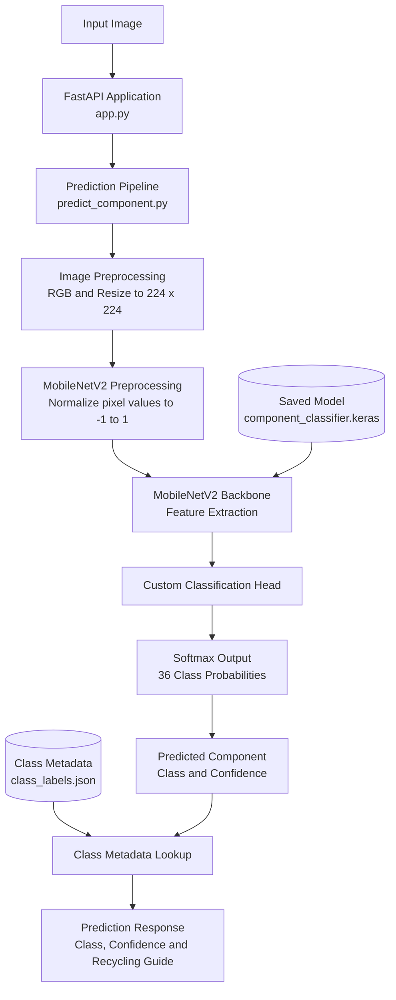
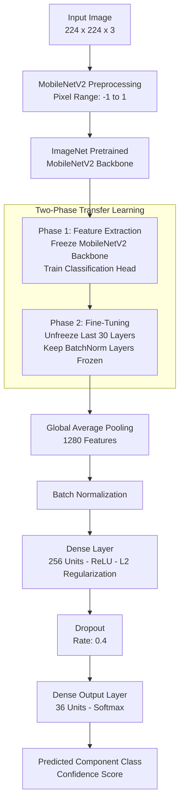
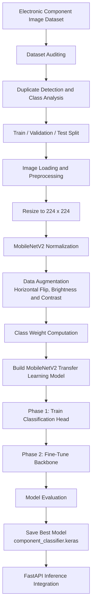

# TechCycle — E-Waste Management & Recycling Intelligence Platform

[](https://react.dev/)
[](https://fastapi.tiangolo.com/)
[](https://keras.io/)
[](https://firebase.google.com/)

**TechCycle** is a full-stack sustainability platform designed to improve electronic waste identification, reuse, and recycling. It combines a computer vision-based component classifier, an e-waste marketplace, recycling center mapping, and an AI-powered sustainability assistant.

The ML subsystem uses **transfer learning with ImageNet-pretrained MobileNetV2** to classify electronic components into 36 categories and provide relevant recycling and handling guidance.

---

## Table of Contents

- [Overview](#overview)
- [Key Features](#key-features)
- [ML System Architecture](#ml-system-architecture)
- [CNN Deep Learning Architecture](#cnn-deep-learning-architecture)
- [Deep Learning Pipeline](#deep-learning-pipeline)
- [Model Evaluation](#model-evaluation)
- [Technology Stack](#technology-stack)
- [Project Structure](#project-structure)
- [Installation and Setup](#installation-and-setup)
- [Testing](#testing)

---

## Overview

TechCycle aims to address the growing electronic waste problem by providing:

1. **AI Component Recognition:** Identifies electronic components from uploaded images using a deep learning classifier.
2. **Circular Economy Marketplace:** Enables users to list, discover, and exchange reusable electronic components.
3. **Recycling Center Locator:** Helps users locate electronic waste collection centers.
4. **Sustainability Assistant:** Provides e-waste-related information through a Gemini-powered chatbot.

---

## Key Features

### AI Component Scanner

- Image-based classification of electronic components.
- Supports 36 component categories.
- Displays predicted class and confidence score.
- Provides relevant recycling and handling guidance.
- Includes low-confidence prediction warnings.

### Circular Marketplace

- Browse and search electronic components.
- List reusable electronics for sale or salvage.
- Manage wishlists and marketplace listings.

### Recycling Center Locator

- Interactive map displaying recycling and collection locations.

### AI Sustainability Assistant

- Gemini-powered conversational assistant for e-waste-related queries.

### Authentication and Database

- Firebase Authentication with Email/Password and Google sign-in.
- Cloud Firestore for application data.
- Firebase Storage integration for device images.

---

## ML System Architecture

The following diagram illustrates the end-to-end inference pipeline, from image upload to component classification and recycling guidance.



### Inference Workflow

1. The user uploads an electronic component image through the React AI Scanner.
2. FastAPI receives the image through the classification endpoint.
3. `predict_component.py` loads and preprocesses the image.
4. The image is resized to 224 × 224 RGB and normalized using MobileNetV2 preprocessing.
5. The preprocessed image is passed to the saved MobileNetV2-based model.
6. The model generates a probability distribution across 36 classes using Softmax.
7. The predicted class is mapped to its corresponding label and recycling guide.
8. FastAPI returns the prediction and confidence information as a JSON response.

---

## CNN Deep Learning Architecture

The classification model uses **transfer learning** with an ImageNet-pretrained MobileNetV2 backbone.

The original ImageNet classification head is replaced with a custom classification head designed for the 36 electronic component categories in TechCycle.



### Model Layer Breakdown

| Layer | Component | Configuration | Purpose |
|---|---|---|---|
| 1 | Input Layer | 224 x 224 x 3 | Accepts RGB images |
| 2 | MobileNetV2 | ImageNet pretrained, include_top=False | Extracts visual features |
| 3 | Global Average Pooling | 1280 features | Reduces spatial dimensions |
| 4 | Batch Normalization | 1280 features | Normalizes extracted representations |
| 5 | Dense | 256 units, ReLU, L2 = 1e-4 | Learns task-specific features |
| 6 | Dropout | 0.4 | Helps reduce overfitting |
| 7 | Output Dense | 36 units, Softmax | Predicts component class |

### Transfer Learning Strategy

**Phase 1 — Feature Extraction**

- Load MobileNetV2 with ImageNet pretrained weights.
- Freeze the entire pretrained backbone.
- Train the custom classification head.
- Use Adam optimizer with learning rate 0.001.

**Phase 2 — Fine-Tuning**

- Unfreeze the final 30 layers of MobileNetV2.
- Keep BatchNormalization layers frozen.
- Fine-tune with a lower learning rate of 0.00001.
- Preserve useful pretrained features while adapting the network to electronic component classification.

---

## Deep Learning Pipeline

The training pipeline consists of dataset preparation, preprocessing, model construction, two-phase training, and evaluation.



### Dataset Details

| Property | Value |
|---|---|
| Total Images | 10,989 |
| Number of Classes | 36 |
| Training Images | 7,709 |
| Validation Images | 1,647 |
| Test Images | 1,633 |
| Input Resolution | 224 x 224 |
| Color Channels | RGB |
| Batch Size | 32 |

### Preprocessing and Data Handling

- Images are decoded and resized to 224 × 224.
- MobileNetV2 preprocessing maps pixel values to the range [-1, 1].
- Data augmentation is applied to training images.
- Class weights are computed using balanced class weighting to address class imbalance.
- A group-based dataset split is used to keep exact duplicate image hashes within the same split.
- TensorFlow data pipelines use batching and prefetching for efficient training.

### Training Configuration

| Parameter | Configuration |
|---|---|
| Base Architecture | MobileNetV2 |
| Pretrained Weights | ImageNet |
| Classification Classes | 36 |
| Optimizer | Adam |
| Phase 1 Learning Rate | 1e-3 |
| Phase 2 Learning Rate | 1e-5 |
| Loss Function | Categorical Crossentropy |
| Batch Size | 32 |
| Dropout | 0.4 |
| Dense Units | 256 |
| Regularization | L2 (1e-4) |
| Early Stopping | Enabled |
| Learning Rate Scheduling | ReduceLROnPlateau |

---

## Model Evaluation

The model is evaluated on a held-out test dataset using multiple classification metrics.

| Metric | Test Result |
|---|---:|
| Accuracy | 48.13% |
| Macro Precision | 0.4857 |
| Macro Recall | 0.4970 |
| Macro F1-Score | 0.4861 |
| Weighted F1-Score | 0.4750 |

### Evaluation Approach

- **Accuracy:** Measures the overall proportion of correct predictions.
- **Precision:** Measures how many predicted instances of a class are correct.
- **Recall:** Measures how many actual instances of a class are correctly identified.
- **Macro F1:** Calculates the average F1-score across classes, giving equal importance to each class.
- **Weighted F1:** Accounts for the number of samples in each class.

The difference between training and validation performance indicates a generalization gap. Further improvements can focus on dataset quality, class imbalance, augmentation strategies, and fine-tuning.

---

## Technology Stack

| Layer | Technologies |
|---|---|
| Frontend | React 19, React Router |
| Styling | CSS |
| Backend | Python, FastAPI, Uvicorn |
| Deep Learning | TensorFlow, Keras 3 |
| CNN Architecture | MobileNetV2 |
| Data Processing | NumPy, Pillow, Pandas |
| ML Utilities | Scikit-learn |
| Database | Firebase Cloud Firestore |
| Authentication | Firebase Authentication |
| Generative AI | Google Gemini API |
| Version Control | Git, GitHub |

---

## Project Structure

```text
TechCycle/
│
├── public/
├── src/
│   ├── components/
│   │   ├── Awareness.js
│   │   ├── Dashboard.js
│   │   ├── Profile.js
│   │   ├── RecyclingMap.js
│   │   ├── Chatbot.js
│   │   └── auth/
│   ├── contexts/
│   ├── firebase/
│   └── styles/
│
├── backend/
│   ├── app.py
│   ├── train_model.py
│   ├── predict_component.py
│   ├── dataset_utils.py
│   ├── class_labels.json
│   ├── models/
│   │   ├── component_classifier.keras
│   │   └── training_config.json
│   ├── reports/
│   │   ├── dataset_audit.json
│   │   └── test_evaluation_report.json
│   └── tests/
│       └── test_ml_pipeline.py
│
├── .env.example
├── package.json
└── README.md
```

---

## Installation and Setup

### Prerequisites

- Node.js 18 or higher
- npm
- Python 3.10 or 3.11
- Git

### 1. Clone the Repository

```bash
git clone https://github.com/somyaparidaa/TechCycle.git
cd TechCycle
```

### 2. Backend Setup

```bash
cd backend

python3.11 -m venv venv

# macOS / Linux
source venv/bin/activate

# Install dependencies
pip install -r requirements-ml.txt
pip install -r requirements.txt

# Run the backend
uvicorn app:app --host 127.0.0.1 --port 8000 --reload
```

The backend will be available at:

- API: http://127.0.0.1:8000
- Health Check: http://127.0.0.1:8000/health
- API Documentation: http://127.0.0.1:8000/docs

### 3. Frontend Setup

Open a separate terminal:

```bash
cd TechCycle

npm install

cp .env.example .env.local
```

Configure the Firebase environment variables in `.env.local` using your own Firebase project credentials.

Start the React application:

```bash
npm start
```

The frontend will be available at:

http://localhost:3000

---

## Testing

### Backend ML Tests

```bash
cd backend

source venv/bin/activate

pytest tests/test_ml_pipeline.py -v
```

The test suite validates:

- Component class metadata.
- Dataset split integrity.
- Image preprocessing.
- Model loading and inference pipeline behaviour.
- Fallback handling.

### Frontend Build

```bash
npm run build
```

---

## Future Improvements

- Improve classification performance through dataset refinement and model experimentation.
- Investigate class-specific errors and generalization gaps.
- Explore improved confidence calibration.
- Extend the inference pipeline with additional electronic component categories.
- Improve real-time integration between the AI scanner and other platform services.

---

## License

This project is licensed under the MIT License. See the [LICENSE](LICENSE) file for details.
